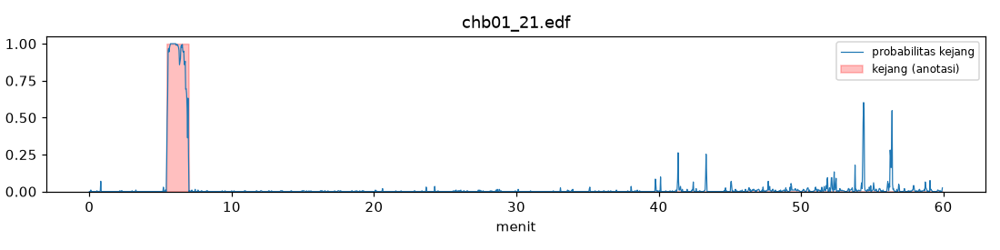
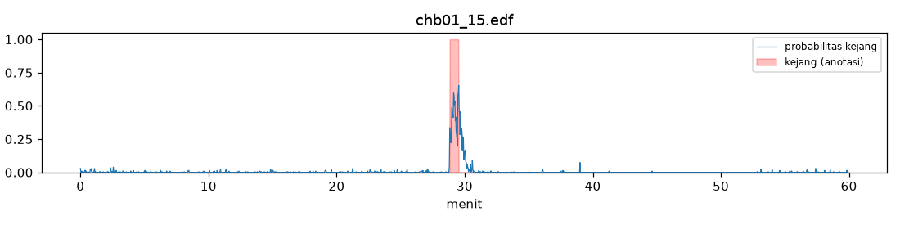
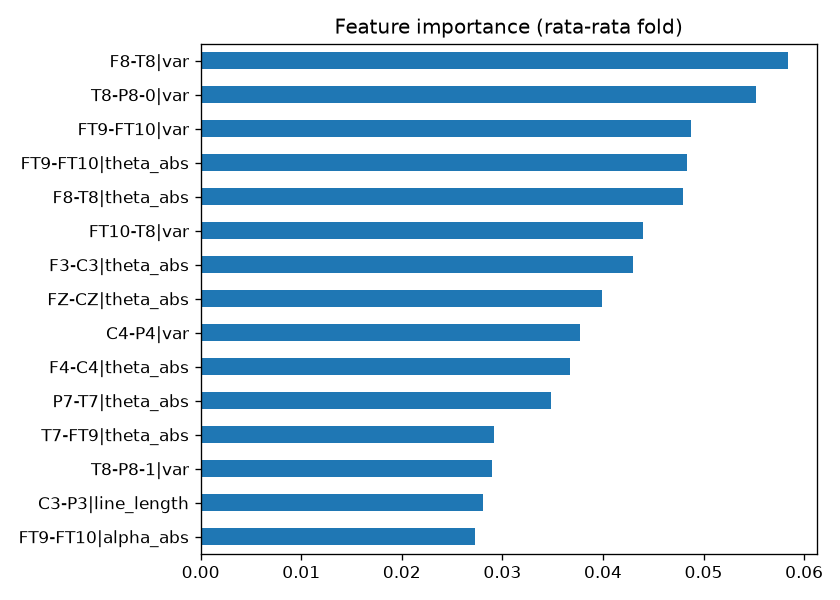

# 01 — Deteksi Kejang dari EEG (CHB-MIT, ML klasik)

**Tempat jalan:** laptop (CPU, RAM 8 GB). Tidak butuh GPU.

## Ringkasan

Model mendeteksi apakah potongan EEG 4 detik mengandung aktivitas kejang.
Data: rekaman EEG kulit kepala anak dari CHB-MIT (PhysioNet), hanya pasien `chb01`, sekitar 10 file (~400 MB), bukan seluruh dataset 42 GB.

## Alur

1. `src/download_subset.py` mengunduh file ringkasan anotasi dan sebagian rekaman `chb01`.
2. `src/features.py` memotong sinyal menjadi jendela 4 detik dan menghitung fitur per kanal:
   daya pita frekuensi (delta, theta, alpha, beta, gamma), variansi, dan *line length*.
3. `src/train.py` melatih Random Forest dan mengevaluasinya dengan **leave-one-recording-out**:
   setiap kali, satu rekaman dipakai sebagai data uji dan model dilatih dari rekaman lain.

Rekaman diproses satu per satu dan hanya fiturnya yang disimpan, sehingga pemakaian RAM tetap kecil.

## Cara menjalankan

```bash
cd 01-eeg-seizure-detection
pip install -r requirements.txt
python src/download_subset.py
python src/train.py
```

Hasil (metrik per rekaman, feature importance, grafik) tersimpan di `outputs/`.

## Keputusan desain

- **Split per rekaman, bukan acak per jendela.** Jendela yang berdekatan dalam satu rekaman sangat mirip.
  Split acak akan membuat skor terlihat jauh lebih tinggi dari kenyataan (*data leakage*).
- **Kelas sangat tidak seimbang** (kejang hanya sebagian kecil dari waktu rekaman).
  Karena itu dipakai `class_weight="balanced"` dan dilaporkan sensitivitas, spesifisitas, dan PR-AUC, bukan akurasi saja.
- **Model per pasien (patient-specific).** Hanya satu pasien, jadi hasil tidak bisa digeneralisasi ke pasien lain.

## Hasil

Data: 10 rekaman `chb01` (7 dengan kejang, 3 tanpa), 17.352 jendela, hanya 226 (1,3%) berlabel kejang.
Setiap rekaman (10 rekaman) diuji sekali dengan model yang dilatih dari 9 rekaman lainnya. Ambang probabilitas 0,5.

**Alarm** adalah satu rangkaian jendela positif yang berurutan. Alarm disebut palsu jika tidak menyentuh jendela kejang sama sekali.

| Rekaman uji | Kejang? | Terdeteksi | Sensitivitas | Spesifisitas | F1 | PR-AUC | Alarm palsu |
|---|---|---|---|---|---|---|---|
| chb01_01 | tidak | – | – | 1,000 | – | – | 0 |
| chb01_02 | tidak | – | – | 1,000 | – | – | 0 |
| chb01_05 | tidak | – | – | 1,000 | – | – | 0 |
| chb01_03 | ya | ya | 0,81 | 1,000 | 0,89 | 0,93 | 0 |
| chb01_04 | ya | ya | 1,00 | 0,997 | 0,82 | 0,99 | 0 |
| chb01_15 | ya | ya | 0,29 | 0,999 | 0,43 | 0,71 | 0 |
| chb01_16 | ya | ya | 0,88 | 0,998 | 0,87 | 0,91 | 2 |
| chb01_18 | ya | ya | 0,70 | 1,000 | 0,82 | 0,99 | 0 |
| chb01_21 | ya | ya | 0,91 | 0,998 | 0,92 | 0,99 | 2 |
| chb01_26 | ya | ya | 0,94 | 0,998 | 0,95 | 0,98 | 1 |

**Ringkasan**

- 7 dari 7 kejang terdeteksi.
- Sensitivitas per jendela rata-rata 0,79 dan PR-AUC 0,93, dihitung pada rekaman yang berisi kejang.
- Ada 5 alarm palsu dalam 9,6 jam rekaman, atau sekitar 0,5 per jam.
- Rekaman tanpa kejang (3 jam) tidak menghasilkan satu pun alarm palsu.





**Interpretasi**

- Ketujuh kejang terdeteksi, setidaknya sebagian jendelanya. Sensitivitas per jendela rata-rata 0,79 dengan spesifisitas hampir sempurna.
- Kasus terlemah adalah chb01_15 (kejang 40 detik). Probabilitas memang naik tepat saat kejang, tetapi puncaknya sekitar 0,6, sehingga hanya sebagian jendela yang melewati ambang 0,5. Ambang yang lebih rendah atau penghalusan antarjendela kemungkinan membantu, dengan risiko alarm palsu bertambah.
- Fitur terpenting adalah variansi dan daya pita theta di kanal temporal kanan (F8-T8, T8-P8, FT10-T8). Ini konsisten dengan kejang ritmis berfrekuensi rendah yang terlokalisasi. Interpretasi ini perlu dicek dengan literatur dan bukan klaim klinis.
- Semua alarm palsu muncul di rekaman yang juga berisi kejang. Pada chb01_21, misalnya, ada lonjakan di menit 54–56 (lihat grafik). Di rekaman normal, model tetap diam. Ada kemungkinan aktivitas EEG di sekitar kejang memang lebih mirip pola kejang, tetapi ini belum diverifikasi.
- Pada chb01_04 ada 6 jendela positif di luar label kejang, tetapi semuanya menempel pada kejang itu sendiri. Kemungkinan besar ini batas awal/akhir kejang, bukan alarm palsu.

Detail lengkap: [results/metrics_per_recording.csv](results/metrics_per_recording.csv), [results/top_features.csv](results/top_features.csv).

## Batasan dan langkah berikutnya

- Satu pasien saja. Langkah berikutnya: tambah 2–3 pasien dan uji lintas pasien (*leave-one-patient-out*).
- Fitur sederhana. Bisa ditambah fitur wavelet (`PyWavelets`) atau entropi.
- Rekaman normal hanya 3 jam. Untuk mengukur alarm palsu per jam dengan andal dibutuhkan puluhan jam. chb01 punya sekitar 40 jam rekaman, tapi akan memakan sekitar 1,5 GB disk.
- Latensi deteksi (berapa detik setelah kejang dimulai alarm muncul) belum diukur. Untuk klinik, yang penting adalah latensi deteksi dan jumlah alarm palsu per jam.

## Sumber data

Shoeb, A. (2009). *Application of Machine Learning to Epileptic Seizure Onset Detection and Treatment.* PhD thesis, MIT.
Dataset: CHB-MIT Scalp EEG Database, PhysioNet (https://physionet.org/content/chbmit/1.0.0/).
